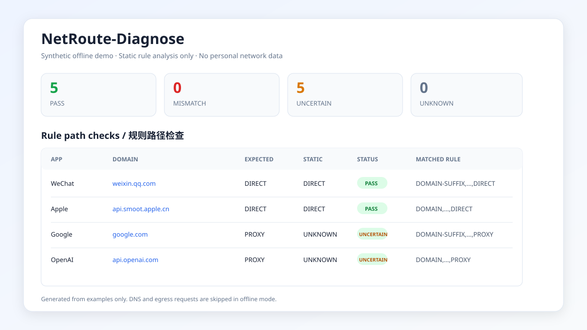
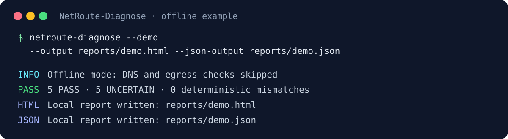

# NetRoute-Diagnose

[English](README.en.md) · [简要首页](README.md)

NetRoute-Diagnose 是一个使用 Python 开发、面向 Clash/OpenClash 用户的只读网络
路径诊断工具。它把 DNS 结果、出口 IP 观测、Clash 规则首命中分析和 App 路由期望
放进同一份 HTML 报告中，帮助定位“某个域名为什么走代理或直连”。

## 适合谁

- 使用 Clash、Mihomo 或 OpenClash，但看不懂长规则列表的用户
- 遇到“微信能用但 Google 不能用”“某个 Apple 服务走错代理”等问题的用户
- 想在分享配置前，用一份只读报告说明 DNS、出口和规则命中情况的用户

你只需要准备一份 Clash/OpenClash YAML 文件。工具不会要求路由器管理密码，也不会
修改网络。第一次使用建议先运行下方离线 Demo。

## 先看 Demo

仓库内附有一份完全由合成配置生成的
[脱敏 HTML Demo 报告](docs/demo-report.html)，不包含真实节点、家庭网络地址或个人
路径。





## 三个典型使用场景

1. **微信意外走代理。** 对比预期的 `DIRECT` 与 Clash/OpenClash 首个命中规则，确认
   是否存在确定性冲突。
2. **Apple、Google 或 OpenAI 路径异常。** 使用内置配置定位相关规则，并查看静态分析的
   置信度。
3. **需要区分路径推断和实际出口。** 对比系统路径、无代理直连或显式 HTTP 代理的出口
   观测，全程不修改网络设置。

## 快速开始

### 普通用户安装

直接安装发布源码包即可，不需要了解 Git 或准备开发环境：

```bash
python -m pip install "https://github.com/HHHTTT-1977/NetRoute-Diagnose/archive/refs/tags/v0.1.1.zip"
```

本版本尚未发布到 PyPI；在项目公告前请勿使用 `pip install netroute-diagnose`。

运行完全离线的示例（不会发送 DNS 或出口 IP 请求）：

```bash
netroute-diagnose \
  --config examples/diagnosis.yaml \
  --clash-config examples/clash-config.yaml \
  --offline \
  --output reports/demo.html
```

使用浏览器打开 `reports/demo.html`。仓库也提供一份
[脱敏 HTML Demo 报告](docs/demo-report.html)。

### 源码开发安装

下载或克隆仓库后，在项目目录中执行：

```bash
python -m venv .venv
source .venv/bin/activate
python -m pip install -e .
```

Windows PowerShell 激活命令为 `.venv\Scripts\Activate.ps1`。

## 功能

- 使用系统 DNS 或指定 DNS 服务器查询 A/AAAA 记录
- 分别检测系统路径、无代理直连和显式 HTTP 代理的公网出口 IP
- 解析 Clash/OpenClash YAML 中的 `rules`
- 支持 `DOMAIN`、`DOMAIN-SUFFIX`、`DOMAIN-KEYWORD`、`DOMAIN-REGEX`、
  `MATCH` 和 `FINAL` 的确定性静态匹配
- 标记 `RULE-SET`、`GEOSITE`、`GEOIP`、IP 规则、进程规则和逻辑规则造成的
  静态分析不确定性
- 对比每个 App 域名的预期路径与规则目标，输出 `PASS`、`MISMATCH`、
  `UNCERTAIN` 或 `UNKNOWN`
- 内置微信、Apple、Google、OpenAI 检测配置
- 生成单文件、可离线打开的 HTML 报告，也可选输出 JSON

## 安全边界

第一阶段只执行读取和网络查询：

- 不修改 Clash/OpenClash YAML
- 不修改订阅、节点、规则、DNS 或系统代理
- 不调用 OpenClash API 切换策略
- 不重启 Clash/OpenClash 或任何系统服务
- 不写入路由器

报告中的“规则路径”来自 YAML 静态分析；“出口 IP”来自单独的 HTTP 请求。两者是
不同证据，工具不会仅凭 DNS 结果或节点名称断言真实流量路径。

## 环境要求

- Python 3.10 或更高版本
- 可读取的 Clash/OpenClash YAML 配置
- 若执行在线检测，需要网络访问

使用内置微信、Apple、Google、OpenAI 配置并执行在线检查：

```bash
netroute-diagnose \
  --clash-config your-clash.yaml \
  --output reports/network-report.html
```

同时输出 JSON：

```bash
netroute-diagnose \
  --clash-config your-clash.yaml \
  --output reports/network-report.html \
  --json-output reports/network-report.json
```

命令在存在确定性 `MISMATCH` 时返回退出码 `2`，配置或运行错误返回 `1`，其余返回
`0`，便于接入自动化检查。

### 三个常见概念

- `DIRECT`：请求不交给代理策略组
- `PROXY`：请求交给某个命名策略组；该组运行时仍可能选择 `DIRECT`
- “静态分析”：只按 YAML 规则顺序推断，不代表工具看到了 App 的真实连接

## 自定义检测配置

复制 `examples/diagnosis.yaml`，然后修改域名与期望路径：

```yaml
dns:
  nameservers: []
  timeout: 3

egress:
  endpoint: https://api.ipify.org?format=json
  timeout: 5
  checks:
    - name: system-route
      mode: system
      enabled: true
    - name: clash-http-proxy
      mode: proxy
      proxy_url: http://127.0.0.1:7890
      enabled: true

apps:
  - name: My App
    domains:
      - domain: example.com
        expected: DIRECT
      - domain: api.example.net
        expected: PROXY
```

`expected` 可使用 `DIRECT`、`PROXY`、`REJECT` 或 `UNKNOWN`。命名策略组（例如
`Proxy`、`自动选择`、`Apple`）会静态归类为 `PROXY`；工具无法知道该策略组运行时
是否选择了 `DIRECT`，因此应结合出口观测和 Clash/OpenClash 运行日志判断。

出口模式：

- `system`：遵循当前进程可见的系统/环境代理设置
- `direct`：禁用 HTTP(S) 代理后请求检测端点
- `proxy`：通过 `proxy_url` 指定的 HTTP 代理请求

## 报告解读

- `PASS`：确定性首命中规则的目标符合预期
- `MISMATCH`：确定性首命中规则的目标与预期冲突
- `UNCERTAIN`：找到了后续规则，但前面存在需要规则集、IP、进程或运行时上下文
  才能判断的规则
- `UNKNOWN`：没有确定性匹配，或预期本身设置为未知

报告会显示规则序号、完整规则文本、策略目标和置信度。规则序号从 1 开始，与 YAML
中的顺序对应。

## 已知限制

- 不下载或展开远程 `rule-providers`
- 不模拟 DNS 解析后可能命中的 `IP-CIDR`/`GEOIP`
- 不读取 Clash 控制器的实时连接、策略组选择或脚本执行结果
- 命名策略组被归类为代理路径，但其运行时可能选择 `DIRECT`
- DNS 成功不代表对应业务流量一定使用相同路径
- 一个出口检测网站只能证明该次请求的出口，不能自动代表所有域名

这些限制会在报告中表现为低置信度或不确定状态，避免把静态推断伪装成真实路径。

## 隐私

- Clash/OpenClash YAML 解析、规则匹配以及 HTML/JSON 报告生成均在本地执行
- 配置文件和报告内容不会上传；NetRoute-Diagnose 不收集用户网络配置，也不提供
  遥测或托管后端服务
- 在线检查是可选的，使用 `--offline` 时会完全跳过
- DNS 检测会把每个配置域名发送给系统 DNS，或诊断配置中明确指定的 DNS 解析器
- 出口 IP 检测会向配置的公网 IP 服务发起 HTTP(S) 请求；默认端点为
  `api.ipify.org`。与所有公网 IP 服务一样，该服务必然能够看到请求源 IP 和常规
  连接元数据
- 在线请求仅用于生成诊断结果；工具不会传输配置文件或报告内容。结果仅保留在本地
  进程中，并写入用户指定的本地输出文件
- 外部 DNS 解析器和公网 IP 服务可能按各自政策处理或记录请求；请选择可信端点，
  或使用 `--offline`
- HTML/JSON 报告只记录配置文件名，不记录本机绝对目录
- 示例中的 `127.0.0.1` 是通用本机回环地址
- 测试使用 `192.0.2.0/24`、`203.0.113.0/24`、`2001:db8::/32` 文档专用地址
- 发布 Issue 前仍建议检查报告中的域名、规则名和出口 IP 是否适合公开

### 数据流

| 操作 | 离开本机的数据 | 目标 | 本地输出 |
|---|---|---|---|
| Clash 规则解析 | 无 | 仅本地进程 | 规则匹配结果 |
| DNS 检测 | 配置中的域名 | 系统 DNS 或指定 DNS 解析器 | 解析地址与错误信息 |
| 出口 IP 检测 | HTTP(S) 请求元数据，包括源 IP | 配置的 IP 服务；默认为 `api.ipify.org` | 观测到的公网 IP 或错误 |
| HTML/JSON 生成 | 无 | 用户指定的本地路径 | 独立报告文件 |

## 开发与测试

```bash
python -m unittest discover -s tests -v
```

项目采用 `src` 布局，核心模块分别负责配置、DNS、出口检测、规则分析、诊断编排和
HTML 报告。欢迎通过 Issue 或 Pull Request 提交新规则类型、报告改进或测试用例。

## License

[MIT License](LICENSE)
